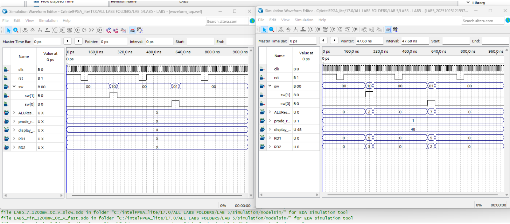
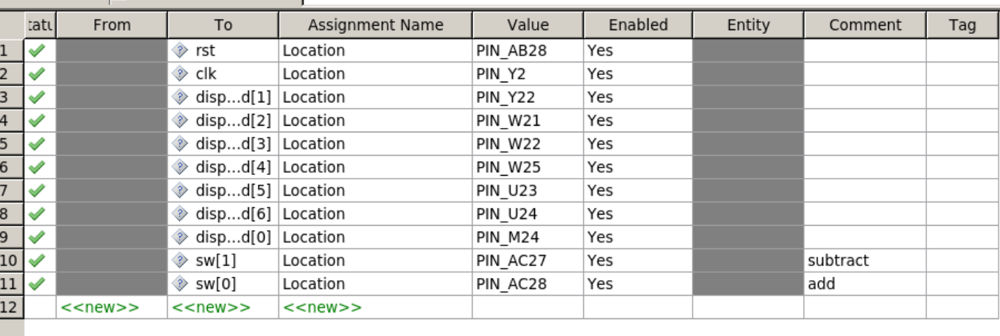
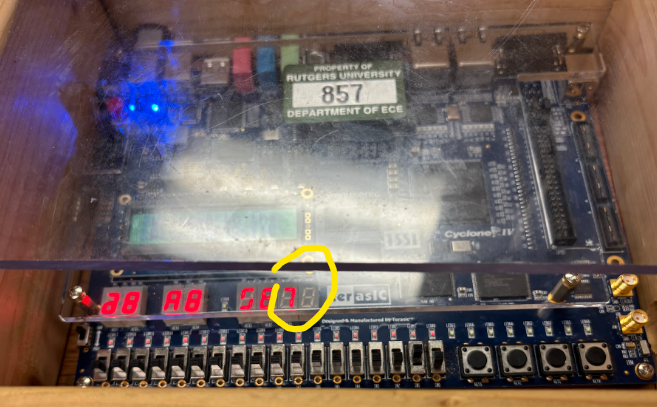
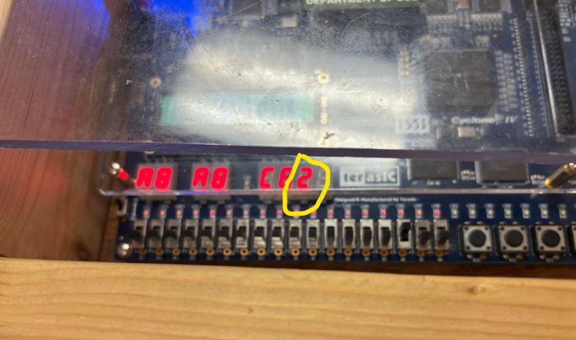

# 32 Bit RISC Datapath and ALU Execution Core (Verilog)

  
  
  
  

## Overview

A synchronous 32 bit processor execution core modeled in SystemVerilog, compiled and synthesized using Intel Quartus Prime, and physically verified on an Altera Cyclone IV E FPGA using the Terasic DE2 115 development board.

The project implements an R type RISC datapath architecture featuring a dual read multiport register file, a dedicated arithmetic functional unit, and an active low seven segment output decoder for real time hardware telemetry.

## Architectural Modules

The design is organized into modular SystemVerilog blocks instantiated within a structural top level wrapper:

* Register File (register_file.sv): Contains 32 general purpose 32 bit registers. Features dual asynchronous read ports (RD1, RD2) for immediate source operand fetch and a single synchronous write port (WD3) clocked on the rising edge. Includes active high synchronous reset logic that initializes register values to their index for simulation validation.

* Arithmetic Logic Unit (ALU.sv): Performs 32 bit arithmetic operations driven by a 3 bit control word. Decodes control signals to execute addition (010) or subtraction (110) while driving results directly to the datapath write back bus.

* Top Level Integration (top.sv): Coordinates signal buses between the register file and the ALU core. Maps input control lines from physical board switches to trigger instruction operations and routes register output to the display subsystem.

* Display Subsystem (display.sv): Decodes internal binary bus values into active low seven segment representations to display register probe values directly on physical board hardware.

## Functional Verification and Waveforms

Functional simulation was executed using ModelSim to validate instruction decoding, register read latency, and ALU arithmetic correctness:

  
   
  <em>ModelSim timing waveform verifying switch trigger inputs, register reads, and ALU outputs for addition (7) and subtraction (2).</em>

* ADD Verification: Reading Register 5 and Register 2 properly triggers the ALU add path, outputting 7 and verifying write back stability.

* SUB Verification: Reading Register 5 and Register 3 routes through the ALU subtraction path, outputting 2 without bus race conditions.

## FPGA Physical Bring Up and Pin Mapping

The design was synthesized in Quartus Prime Lite Edition and mapped to the onboard peripherals of the Altera Cyclone IV E FPGA:

  
   
  <em>Physical pin planning in Quartus mapping board clock, active high reset, instruction switches, and seven segment LED busses.</em>

Hardware execution was validated live on bench silicon using onboard switches and observing decoded output on seven segment indicators:

  
  
   
  <em>Hardware bench results on Terasic DE2 115 board validating real time execution: ADD (5 + 2 = 7) and SUB (5 - 3 = 2).</em>

## EDA Tools and Target Silicon

* Hardware Description Language: SystemVerilog

* Synthesis and Implementation: Intel Quartus Prime Lite Edition

* Functional Simulation: ModelSim Altera Edition

* Target Silicon: Altera Cyclone IV E (EP4CE115F29C7) on Terasic DE2 115
